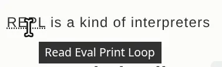

## `abbr`

> When including an abbreviation or acronym, provide a full expansion of the term in plain text on first use, along with the <abbr> to mark up the abbreviation. This informs the user what the abbreviation or acronym means.
>
> https://developer.mozilla.org/en-US/docs/Web/HTML/Reference/Elements/abbr

略語などを明示するtag。

```html
<p><abbr title="Read Eval Print Loop">REPL</abbr>
is a kind of interpreters.</p>
```

<p><abbr title="Read Eval Print Loop">REPL</abbr>
is a kind of interpreters.</p>

カーソルをホバーすると`title=""`の中身が見える。


## Description list :: `<dl>` `<dt>` `<dd>`

> Common uses for this element are to implement a glossary or to display metadata (a list of key-value pairs).
> 
> https://developer.mozilla.org/en-US/docs/Web/HTML/Reference/Elements/dl

key-valueなデータをリストで表示する際に便利。たとえば以下のようなSNS一覧とか。

```html
<dl>
  <dt>Twitter</dt>
  <dd>
    <a href="https://x.com/rei78_4e">rei78_4e</a>
  </dd>

  <dt>GitHub</dt>
  <dd>
    <a href="https://github.com/rei78-4e">rei78-4e</a>
  </dd>

  <dt>Instagram</dt>
  <dd>
    <a href="https://www.instagram.com/rei_78_4e/">rei78_4e</a>
  </dd>

  <dt>Matrix</dt>
  <dd>
    <a href="https://matrix.to/#/@rei78:matrix.org">@rei78:matrix.org</a>
  </dd>
</dl>
```
👇

<dl>
  <dt>Twitter</dt>
  <dd>
    <a href="https://x.com/rei78_4e">rei78_4e</a>
  </dd>

  <dt>GitHub</dt>
  <dd>
    <a href="https://github.com/rei78-4e">rei78-4e</a>
  </dd>

  <dt>Instagram</dt>
  <dd>
    <a href="https://www.instagram.com/rei_78_4e/">rei78_4e</a>
  </dd>

  <dt>Matrix</dt>
  <dd>
    <a href="https://matrix.to/#/@rei78:matrix.org">@rei78:matrix.org</a>
  </dd>
</dl>
