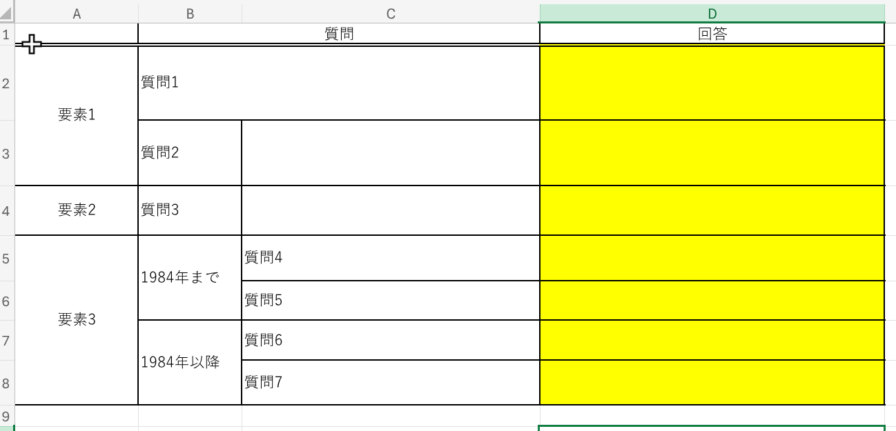

この話の多くは大学などの学校における経験に基づきます. (まだ会社とか経験ないので)

---

まとめというか

- Officeはハイパワーだけれど, 難しいソフトウェア
- 慣れるためだとか, 理由は理解できる
- それはそれとして, プロジェクトファイルの提出はおかしい

## Officeは難しい

### Excelは組版ではない

過去記事([Excelは組版じゃない](https://rei78.cc/blog/excel-is-not-typesetting/))でも似たようなことは書いています.

私の通う学校ではよく.xlsxファイルがワークシート的なものとして配布されます. しかしそこで配れられる.xlsxの多くはExcelを使う意味のない, もしくはExcelの使い方を間違えているものです.

具体例として, 以下はある授業で配布された資料です(質問等については加工しています). セル結合だとか色々文句はありますが, そもそもこういった*ただの表*をExcelを用いて記述すること自体が間違っています. 基本的にExcelの表は2次元なので2軸での表現が限界です.

要素というかカテゴリーか.

## そもそもプロジェクトファイル
## 大学とかが提出に.xlsxだとか.pptxを指定する

## OfficeはOffice suiteなんですよ
